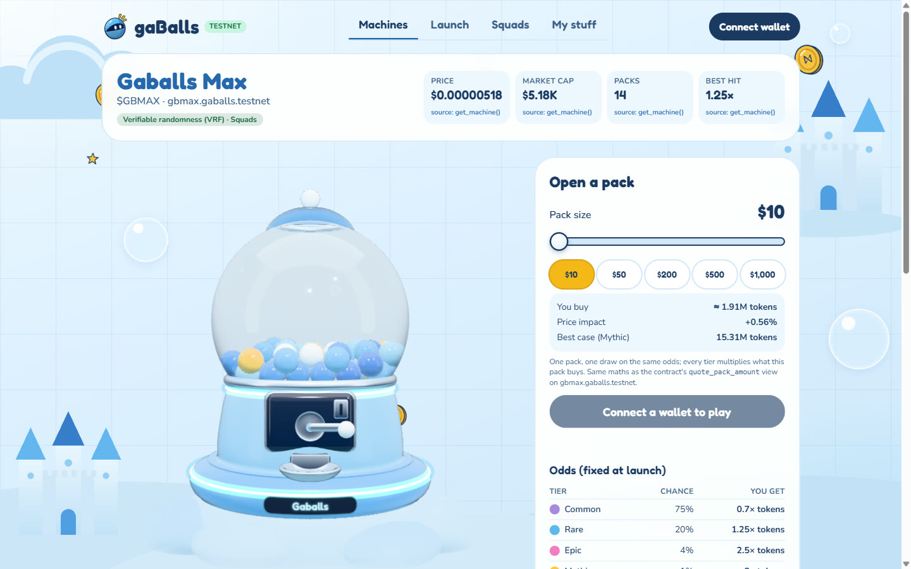
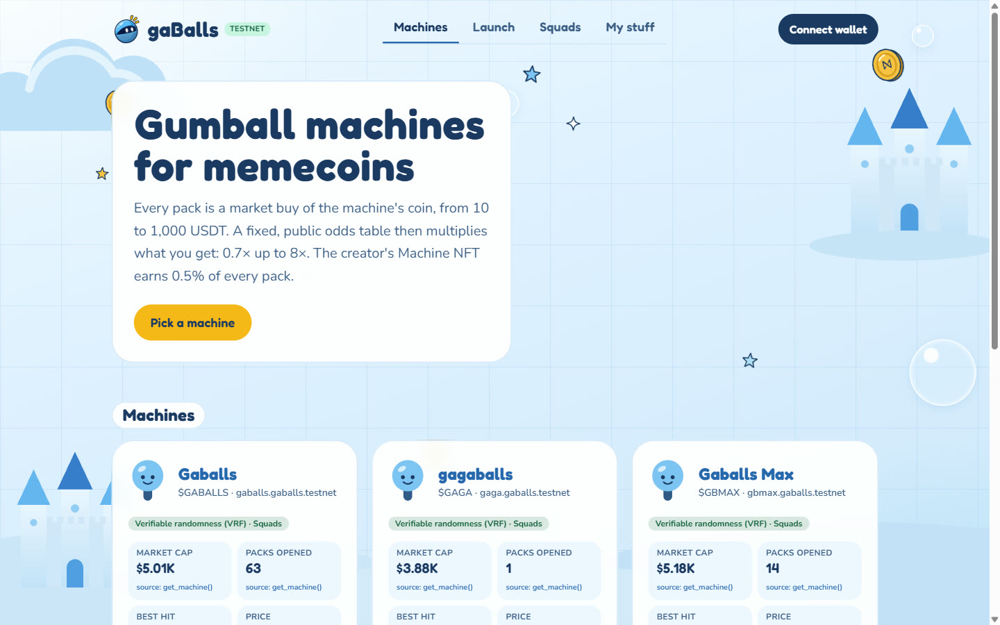
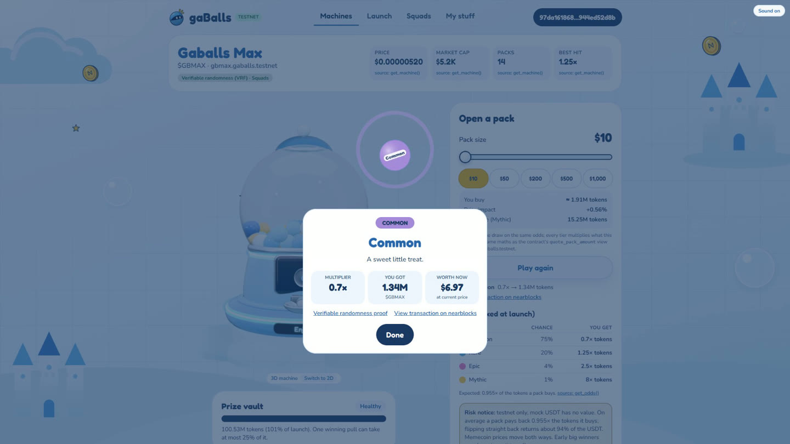
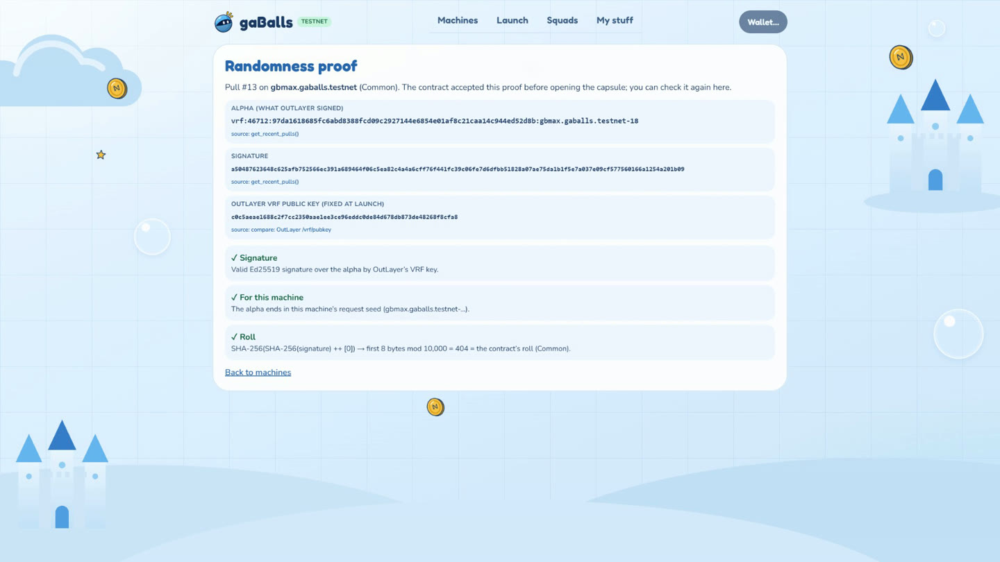
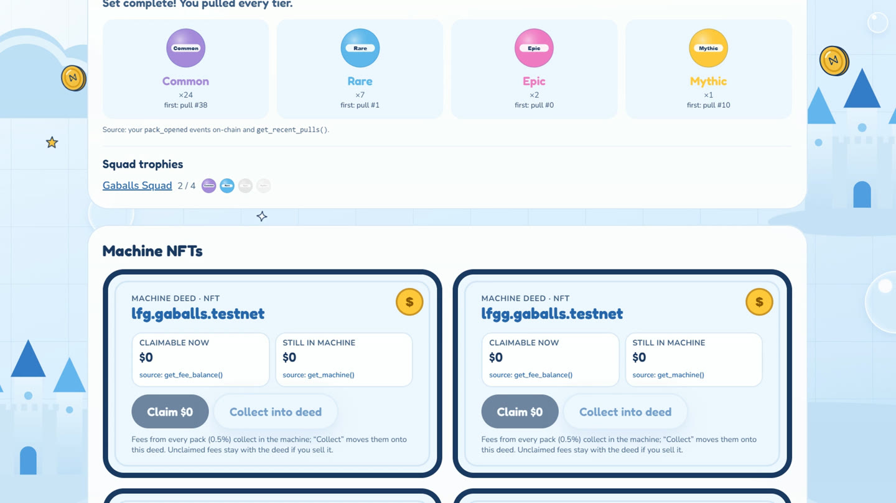
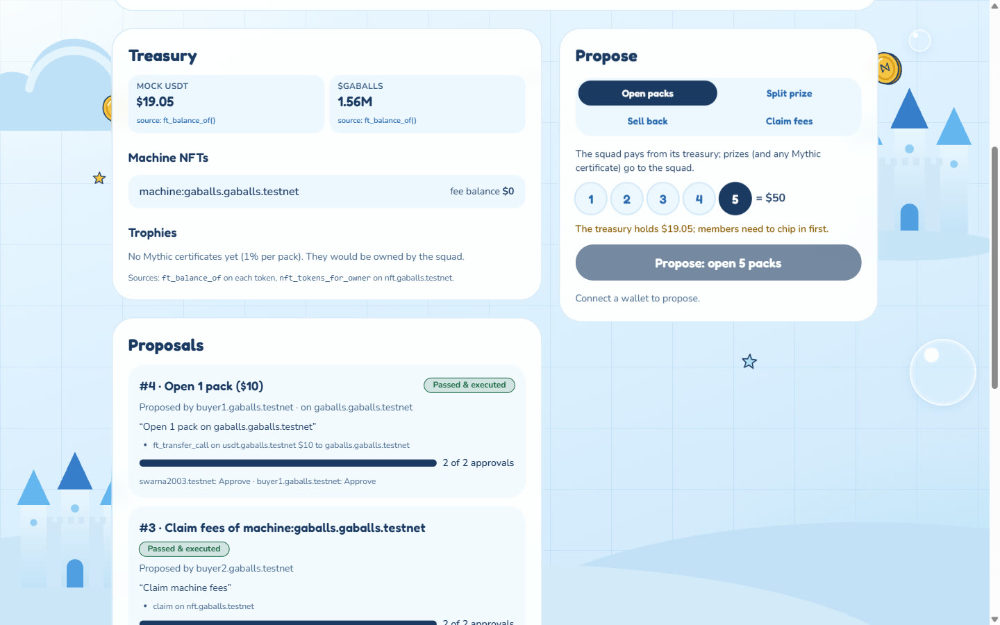
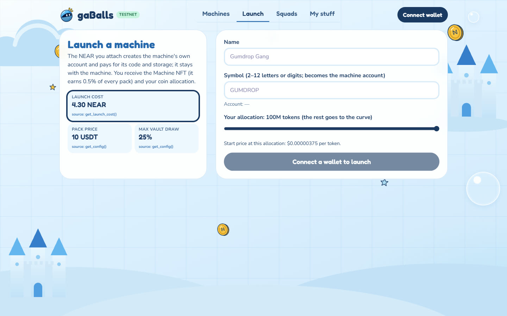

<p align="center">
  
</p>
<h1 align="center">gaBalls</h1>
<p align="center">
  <b>Gumball machines for memecoins, on NEAR.</b> Receipts for every roll.<br>
  <a href="https://gaballs.vercel.app">Live app (testnet)</a> ·
  <a href="docs/proof/gaballs-demo.mp4">Demo video</a> ·
  <a href="docs/DEPLOYMENTS.md">Deployments</a> ·
  <a href="docs/THREAT_MODEL.md">Threat model</a>
</p>
<p align="center">
  
</p>

A gacha launchpad on NEAR. A creator launches a memecoin together with a gacha machine. Every pack (10 USDT, or any
size from 10 to 1,000 USDT on newer machines) is a market buy of that coin on the machine's own bonding curve; a
random draw from a fixed, public odds table then multiplies what the buyer receives. Commons feed a prize vault; Rare/Epic/Mythic pulls draw from it. The creator
holds a transferable Machine Ownership NFT that accrues creator fees in its own balance.

Built at NEAR HACKATHON 2026. Tracks: `memecoins` (primary), `nfts`, `social`, `games`.

| Track | What in this repo fits it | Where |
| --- | --- | --- |
| `memecoins` | Every launch is a NEP-141 coin whose only way in is a gacha pack: a market buy on its own bonding curve, multiplied by a fixed public odds table, with a prize vault fed by Commons. No admin can change odds, curve or fees after launch. | §1, §2, §3 |
| `nfts` | The Machine Ownership NFT holds money: creator fees accrue in the NFT's own balance, move with it on transfer, and only the current owner can claim. Mythic pulls mint soulbound certificates. | §3, [docs/THREAT_MODEL.md](docs/THREAT_MODEL.md) |
| `social` | Squads: a Sputnik DAO v2 opens packs, splits prizes and co-owns a Machine NFT by vote. | [§4](#4-social-money-squads) |
| `games` | The game loop (pull → reveal → Collection → sell) runs for a Google/email player with no wallet, no seed phrase and no wallet popups; MetaMask players get an `0x` NEAR account. | [§5](#5-no-wallet-needed), [§6](#6-the-game-loop) |

**Demo video (1:34):** [docs/proof/gaballs-demo.mp4](docs/proof/gaballs-demo.mp4), recorded on the live testnet app.

**Live app (testnet):** https://gaballs.vercel.app. Sign in with Google/email (no wallet needed), MetaMask, or any NEAR
wallet; get free mock USDT on "My stuff". Everything is on NEAR **testnet**; mock USDT is not real money.

## Screenshots

All taken on the live testnet app (https://gaballs.vercel.app).

| | |
| --- | --- |
| <br>**Home:** every machine with its market cap, packs opened and best hit, each number linked to its on-chain source. | <br>**Reveal:** the capsule opens with the tier, multiplier, tokens received and their value, plus links to the randomness proof and the transaction. |
| <br>**Randomness proof:** the OutLayer VRF alpha, signature and key for one pull, re-checked in the browser. | <br>**My stuff:** the Collection (filled from on-chain pulls) and the creator's Machine NFTs with their fee balances. |
| <br>**Squad:** a Sputnik DAO's treasury, the Machine NFT it co-owns, and its proposals with votes. | <br>**Launch:** name, symbol and creator allocation; the launch cost and fixed parameters are read from the factory. |

## 1. Problem and mechanic

Memecoin launches are a race to buy first and a chart to watch; there is nothing to *do* with the coin. Gaballs turns
buying into a game with rules anyone can read:

- A creator launches a coin and its gacha machine in one transaction (`gaballs.testnet` → `launch()`); the machine *is*
  the coin's contract.
- A pack costs 10 USDT; on machines launched from 2026-11-13 the buyer picks any size from 10 to 1,000 USDT (one
  draw, same odds). The USDT buys the coin on the machine's own bonding curve, so every pack moves the price.
- A verifiable random draw (OutLayer VRF, checked on-chain) picks a tier from the fixed table in §2 and multiplies the
  tokens bought. Commons (0.7×) leave 30% of their tokens in a prize vault; Rare/Epic/Mythic pulls take their extra
  from that vault, capped at 25% of it per pull.
- On average a pack pays back 0.955× the tokens it buys; the 4.5% difference fills the vault. Tokens can be sold back
  to the curve at any time.
- The creator's Machine NFT collects 0.5% of every pack (0.2% goes to the platform). Sell the NFT and its unclaimed
  fees go with it.

## 2. Economics (fixed at launch, readable on-chain)

| Tier | Chance | Multiplier |
| --- | --- | --- |
| Common | 75% | 0.70x |
| Rare | 20% | 1.25x |
| Epic | 4% | 2.50x |
| Mythic | 1% | 8.00x (+ certificate NFT) |

Chosen curve / vault / cap parameters and the simulation behind them: [docs/PARAMETERS.md](docs/PARAMETERS.md).
Re-run the simulation: see [sim/README.md](sim/README.md).

## 3. Architecture

| Contract | Testnet account | Source | What it does |
| --- | --- | --- | --- |
| Factory | `gaballs.testnet` | `contracts/factory` | Stores the machine wasm; `launch()` creates `<symbol>.<factory>` with no access keys, registers it on USDT, mints its Machine NFT |
| Machine + token (one per launch) | flagship `gaballs.gaballs.testnet` ($GABALLS) | `contracts/machine` | NEP-141/145/148 memecoin + bonding curve + gacha pulls + prize vault; `sweep_fees()` sends fees to the NFT |
| NFT (Machine NFT + Mythic certificates) | `nft.gaballs.testnet` | `contracts/nft` | NEP-171/177/178/181; Machine NFTs hold a USDT fee balance only the current owner can claim; certificates are soulbound |
| Mock USDT (testnet) | `usdt.gaballs.testnet` | `contracts/mock-usdt` | NEP-141, 6 decimals, `faucet()` = 100 USDT per account per hour |
| Welcome kit (app server, not a contract) | `gaballs-welcome.testnet` | `app/src/server/welcome.ts` | Pays gas and token registration for new Google/email and MetaMask players (§5) |
| OutLayer (external, not ours) | `outlayer.testnet`, project `zavodil2.testnet/vrf-ark` | [out-layer/vrf-example](https://github.com/out-layer/vrf-example) | Runs the VRF module; returns an Ed25519 signature over `vrf:{request_id}:{buyer}:{seed}` |

Code hashes and every deployment transaction (with nearblocks links): [docs/DEPLOYMENTS.md](docs/DEPLOYMENTS.md). Flagship parameters (read
with `get_machine`): pack 10 USDT (newer machines such as `gbmax.gaballs.testnet`: any size from 10 to 1,000 USDT,
`config.max_pack_price`), V = 3,000 USDT, vault seed 100M, creator allocation 100M, curve 800M, cap 25%,
fees 0.5% + 0.2%, VRF timeout 300 blocks.

How the money flows: buyer → `usdt.ft_transfer_call(machine, 10 USDT)` → machine keeps 9.93 USDT in its curve, accrues
0.05 USDT for the Machine NFT and 0.02 USDT for the platform → `sweep_fees()` → `usdt.ft_transfer_call(nft, fees,
{"token_id":"machine:<machine>"})` → the NFT contract credits that token → its current owner calls `claim`.

**Randomness (OutLayer VRF).** Paying for packs does not roll anything yet: `ft_on_transfer` records a *pending pull*
(event `pack_requested`) and asks OutLayer for one VRF proof (the machine pays ~0.0012 NEAR from its own balance;
unused deposit is refunded to it). OutLayer's worker signs `alpha = vrf:{request_id}:{buyer}:{machine}-{n}` with its VRF
key. About a minute later the machine's callback checks, on-chain:

1. `env::ed25519_verify(signature, alpha, pubkey)` against the OutLayer public key fixed at launch
   (`get_machine().config.vrf.pubkey_hex`, fetched from `https://testnet-api.outlayer.ai/vrf/pubkey` at deploy time);
2. that `alpha` is for this buyer and this pull's unique seed (a valid proof from another request is rejected);
3. then rolls pack *i* as `SHA-256(SHA-256(signature) ++ [i])`, first 8 bytes mod 10,000. OutLayer's own `value`
   field is ignored.

Any failure refunds the USDT (`pack_refunded`, never a panic). If no answer arrives, anyone can call
`refund_expired(request_id)` after 300 blocks (~5 minutes). Each pull stores its `vrf_alpha` and `vrf_signature`, and
the app's "Verifiable randomness proof" link (`/proof`) re-checks both in the browser.

**Sell-back.** `sell(amount, min_usdt_out)` (attach 1 yoctoNEAR) returns tokens to the curve at
`usdt_out = (V+R) - (V+R)·T/(T+s)` (seller gets the floor), takes the same 0.5% + 0.2% fees out of it, and fails if the
curve would need more USDT than it holds or if the payout is below `min_usdt_out`. `quote_sell(amount)` shows the numbers
first. If the USDT transfer fails, the callback puts the tokens, curve and fees back.

**The flagship is `gaballs.gaballs.testnet` ($GABALLS)**, the machine the squads use; it runs machine code
`a43447c8…5935`. Machines launched after the variable-pack-size update (2026-11-13), such as **Gaballs Max**
(`gbmax.gaballs.testnet`), run the factory's current code `f8a79bab…cde5`: the same features plus any pack size from
10 to 1,000 USDT. The app lists both as current machines. Machines are keyless and can never be upgraded, so older
ones stay playable under "Legacy machines" in the app: `gball`, `lfg`, `lfgg` (v1: block randomness, no sell-back) and
`gumball`, `bubbles` (the first VRF version, whose proof check required the payer to sign, so squads could not pull).
Anyone can launch a machine, so the list can also hold machines launched by other people (for example `lfgggg`).
The current machine accepts a proof signed by any account as long as it carries this pull's unique seed; why that is
safe is in [docs/THREAT_MODEL.md](docs/THREAT_MODEL.md).

## 4. Social Money: Squads

**Built on Sputnik DAO (`sputnikv2.testnet`), no custom multisig.** A squad is a standard Sputnik DAO v2 whose council
is its members: they chip in USDT, vote on FunctionCall proposals to open packs on the flagship machine, and split the
prize, sell it back, or claim the fees of a Machine NFT the squad owns. The app's **Squads** page builds each proposal;
`scripts/squad-demo.sh` proves the whole loop on testnet. All links below are in [docs/DEPLOYMENTS.md](docs/DEPLOYMENTS.md#squads).

| What | Proof |
| --- | --- |
| The squad DAO, created on the Sputnik factory (council swarna2003, buyer1, buyer2; 2 of 3) | [`gaballs-squad.sputnikv2.testnet`](https://testnet.nearblocks.io/address/gaballs-squad.sputnikv2.testnet) · creation [A5F78LhA…](https://testnet.nearblocks.io/txns/A5F78LhAyrPhAeWXhgVSfoenHJBDKNoKztxQnoeCEMf8) |
| Members chip in USDT | [cc2imGtc…](https://testnet.nearblocks.io/txns/cc2imGtcwSYPAUWp5ViaA2H3KVBSFWsyvxxPnB1noZH), [HNk2bcCe…](https://testnet.nearblocks.io/txns/HNk2bcCeNN7MpKHYERvB2tz6oY55A4fLjD7RnNz5hkHL) |
| Proposal #0: open 5 packs (USDT `ft_transfer_call` from the DAO, 270 Tgas) | proposed [3rwRrc2g…](https://testnet.nearblocks.io/txns/3rwRrc2gym4QvGVxR1Bomkedo4rFdxGQ1eaKcHLiZLBe) |
| Votes: buyer1 approves, buyer2's approval executes it | [FnvttJ31…](https://testnet.nearblocks.io/txns/FnvttJ31E5dckiCigb5ME5YghhRQBtnWzjLw531TehuW), [79uiAjGR…](https://testnet.nearblocks.io/txns/79uiAjGRp9S5rZKADjxuSWWNEmXoLBQkBx2B1P8ujHm5) |
| The pull: 5 packs settled by an OutLayer VRF proof (signed by the voter, paid to the DAO); 10,361,670 GABALLS land in the treasury | same vote transaction; `get_recent_pulls` on `gaballs.gaballs.testnet` shows `buyer: gaballs-squad.sputnikv2.testnet` |
| Proposal #1: split 20% to each member (registers them on the token first) | [Bi3fbJkY…](https://testnet.nearblocks.io/txns/Bi3fbJkY5zSAJXGL72uEixw5LZgq23iwVf9JTjJC3cNb) → executed [66iYxDdV…](https://testnet.nearblocks.io/txns/66iYxDdVN5GLD2hsZATshZQdDk1qTg1rnMkuV18FK85G) |
| Proposal #2: sell the rest back; 18.292192 USDT returns to the treasury | [2B5ucVd2…](https://testnet.nearblocks.io/txns/2B5ucVd2MVDNwiz1ZszNVZf4HPbfQN5cVjv5otvfHdKR) → executed [9F2Dh8M5…](https://testnet.nearblocks.io/txns/9F2Dh8M5Pp3XpEWLMZ3idXvqAxo4eBRfCMsimAeUdpET) |
| Co-owned machine: the GABALLS Machine NFT is given to the DAO | [3ppyf6q4…](https://testnet.nearblocks.io/txns/3ppyf6q4m4QaT3ekB5VZW87fVd8G6Cemmd4mXSyYwGaj) |
| Fee claim by vote (proposal #3): 0.753631 USDT of fees into the treasury | swept [mFJ2VdBv…](https://testnet.nearblocks.io/txns/mFJ2VdBvTb573XeFEAvQ54tWqsuPu2GC5hvdf78PWEU), proposed [5ir1EMXP…](https://testnet.nearblocks.io/txns/5ir1EMXPpDt7srLziHmzMNDzoZ4Mm6BYFhi4V9UWdYSj), executed [BN7DPkci…](https://testnet.nearblocks.io/txns/BN7DPkci2FjwGCAXubxdfdvAh72MULLMwmZEHvhtrHwa) |

Check it yourself: `near contract call-function as-read-only gaballs-squad.sputnikv2.testnet get_proposals json-args
'{"from_index":0,"limit":10}' network-config testnet now` (statuses and votes), and `get_policy` (council, threshold 2).
The DAO's code hash is the factory's default (`AA4nA45v…dgcH`, Sputnik v3.31); the sandbox test
`sputnik_dao_squad_opens_packs_by_vote_and_receives_the_prize` runs that same wasm (`tests/sandbox/res/`).
Trezu was not linked: we found no sign it supports testnet DAOs, so the app links each squad on nearblocks.

## 5. No wallet needed

The connect dialog offers three ways in. The contracts don't change: every way ends with a NEAR account that signs
the same `ft_transfer_call` to open a pack.

| Sign in with | NEAR account you get | Signing | Wallet windows during play |
| --- | --- | --- | --- |
| **Google / email** ([Privy](https://docs.near.org/web3-apps/tutorials/privy), "Direct Privy") | an implicit account (64 hex characters), created by Privy's embedded NEAR wallet | silent, via Privy `signRawHash` (`app/src/providers/privy-bridge.tsx`) | none |
| **MetaMask or another 0x wallet** (near-connect's built-in "Ethereum Wallets", sign page `evm-on-near.dev`) | the `0x…` address itself, as a NEAR account | one MetaMask approval per transaction (`rlp_execute` on the player's own account) | one per transaction |
| **NEAR wallet** (near-connect: MyNearWallet, Meteor, HOT, Intear, …) | your existing account | your wallet | one per transaction |

**Welcome kit.** New Google/email and MetaMask accounts start with 0 NEAR, so they could not pay gas or storage. On the
first login the app calls `POST /api/welcome`; a server-only account (`gaballs-welcome.testnet`, its key only in a
Vercel secret env var, never in the repo or the browser) sends 0.5 testnet NEAR and pays the player's storage
registration on mock USDT and on $GABALLS: three transactions, shown to the player with links.

Limits, all checked before anything is sent (`app/src/server/welcome.ts`):
- only implicit (64 hex) or `0x` accounts; once per account (an account already registered on mock USDT is refused,
  checked on-chain, plus a cache mark and an in-flight lock against parallel requests);
- a Google/email (implicit) account needs a **verified Privy login**: the browser sends its Privy access token, the
  server checks it (ES256, issuer `privy.io`, audience = our Privy app id, against the public keys Privy publishes for the app;
  `app/src/server/privy-auth.ts`), and each Privy user gets one kit ever. Anyone can make up account ids, so the
  login, not the account id, is what is counted;
- MetaMask (`0x`) accounts have no login to check, so they get their own share: at most 4 kits per day;
- 3 kits per IP per day and 15 per day overall (Vercel Runtime Cache; per region, best effort; Vercel sets the
  client IP header itself, so it cannot be faked);
- the kit switches itself off with a friendly message when the account holds less than 1 NEAR.

Checks: `curl -s -X POST https://gaballs.vercel.app/api/welcome -H 'content-type: application/json' -d '{"accountId":"<any 64 hex>"}'`
→ `401` "Log in with Google or email to get the welcome kit."

Security headers on every response (`app/next.config.ts`): `X-Frame-Options: DENY` and
`Content-Security-Policy: frame-ancestors 'none'` (no site can frame Gaballs, which matters because Google/email
players sign without a popup), `X-Content-Type-Options: nosniff`, `Referrer-Policy`, `Permissions-Policy`.
Check: `curl -sI https://gaballs.vercel.app/ | grep -i frame`.

Why 0.5 NEAR: a pack attaches 300 Tgas, and NEAR holds that gas at a pessimistic price (~0.30 NEAR) before running;
most is refunded, a pack really costs ~0.002–0.01 NEAR.

**MetaMask notes.** The dialog adds NEAR Protocol Testnet (chain 398) to MetaMask before sign-in, and transactions
through that wallet are capped at 270 Tgas (the sign page's limit). We tried NEAR Auth (fast-auth) first; its shared
testnet client only accepts a localhost callback and opens a window for every signature, so we use Privy.

Proof (all links in [docs/DEPLOYMENTS.md](docs/DEPLOYMENTS.md)):

| Path | Account | Kit | Faucet | Pack → result | Sell |
| --- | --- | --- | --- | --- | --- |
| Google/email (Privy test login), screenshots in [docs/proof/google-login/](docs/proof/google-login/) | `97da1618…44ed52d8b` | [4HLceLHf…](https://testnet.nearblocks.io/txns/4HLceLHfiE5C6tYAzzpKWMJonnZPCWdnBYhzW56fyVbN), [7xbkjkMN…](https://testnet.nearblocks.io/txns/7xbkjkMNj94Ri1gC8tMLWUjTX1ZU1RQsmDWCWF5NbKCp), [2HLoaqPk…](https://testnet.nearblocks.io/txns/2HLoaqPktbkbrLLTBQhbRRBKKs4P9zAcp6Fu4TgLt9zG) | [4SNjRGYS…](https://testnet.nearblocks.io/txns/4SNjRGYSqAA2r9X85xJZHpexp45n77xeor9brNUsUUzZ) | [4hyB6thn…](https://testnet.nearblocks.io/txns/4hyB6thnJPH5azWnyv2FJFkWbiYdhZz9egYqL8VLdDcV) → pull #38, Common | §6 |
| MetaMask (throwaway account, on the live site) | `0xd4513c89…54f372eb` | [GQtCqE1f…](https://testnet.nearblocks.io/txns/GQtCqE1fQuHCbdpxrVPZfJTzJNYa9BD7ksZP9JTPMmPo), [BnasRQyA…](https://testnet.nearblocks.io/txns/BnasRQyAASRSQq4WtXSWV7D7xkmbH9xyatWuZn3bb2f7), [5GWeg2G4…](https://testnet.nearblocks.io/txns/5GWeg2G4xeLkZ8bZR9WUbMEpFin5Amggr3G5NQkUMsUk) | [EygvLFtC…](https://testnet.nearblocks.io/txns/EygvLFtCfjQdSauvuCxvnTpSfQe97ZjtTJSF2Kvtadw4) | [HyooQGpa…](https://testnet.nearblocks.io/txns/HyooQGpaX1iPVaQHRrdb25423QRnaaZXnwmYGQa2RpvS) → pull #39, Rare | [6iShdneT…](https://testnet.nearblocks.io/txns/6iShdneTrtgPnMqbWaDY7G3iA26a2RHasFoEZxbgc3eN) |

## 6. The game loop

Every 30 seconds: pick 1–5 packs (on newer machines, a pack size from 10 to 1,000 USDT on a slider) and turn the
crank (or press **Open pack**). Every minute: a capsule drops and the
reveal shows the tier, the tokens and their value now. Every session: fill the **Collection** on My stuff, the four
tier characters, each filled in from the player's own pulls on-chain (not from the browser), with "N / 4 collected",
a small celebration when the set is complete, and the trophies of squads the player is a council member of. Then sell
the tokens back, or hold them while other players' packs push the price up.

Where the Collection comes from (`app/src/lib/collection.ts`): the player's `pack_opened` events (NearBlocks' token
history finds the transactions, NEAR RPC returns their logs; the VRF settlement runs inside the buyer's transaction),
merged with `get_recent_pulls` on every machine, keyed by machine and pull id.

**Play it without a wallet** (needs an email inbox, ~3 minutes):

1. Open https://gaballs.vercel.app → **Connect wallet** → **Continue with Google / email** → enter the code Privy
   emails you → a "You're in!" box lists three welcome-kit transactions.
2. **My stuff** → **Get 100 mock USDT**.
3. **Machines** → **Play** on a machine card → open a pack → after about a minute the capsule drops and the reveal
   shows your tier, tokens and a "Verifiable randomness proof" link. No wallet window opens at any point.
4. **My stuff** shows your **Collection** (your tier filled in, "1 / 4 collected") and a **Sell** button.

**No-popup proof, recorded with Playwright.** `app/e2e/no-popup-loop.spec.ts` plays the loop as a Google/email player
(login → open 1 pack → reveal → Collection → sell all) and **fails if any extra window, tab or browser dialog opens**.
Run it (needs a Privy test login in `app/.env.local`: `PRIVY_TEST_EMAIL`, `PRIVY_TEST_OTP`, from Privy dashboard →
User management → test accounts): `cd app && npx playwright test --headed` → `1 passed`; it writes a video and
screenshots to `docs/proof/game-loop/` (not committed: they show the test login). A passing run on 2026-11-12: pack
[6u3v6h8B…](https://testnet.nearblocks.io/txns/6u3v6h8B4hhsRi2ADuG6vVGK9LTCoPzyAhyUNAVgLWvB) (Common, 0.7×,
1.54M GABALLS), sell [9gPAcQhc…](https://testnet.nearblocks.io/txns/9gPAcQhcve9w8kVKNAZcerKdDiCBASmseg4qzRuNupem),
0 extra windows.

## 7. Top up from any chain (NEAR Intents)

**My stuff → Top up from any chain** quotes how much of another chain's token buys 1–5 packs' worth of **real USDT
(`usdt.tether-token.near`) on NEAR mainnet**, through the [1Click API](https://docs.near-intents.org/integration/distribution-channels/1click-api/about-1click-api).
NEAR Intents has no testnet (hackathon rules Q-007), so this is the mainnet path; packs in the game still use mock USDT.

- Pay with: USDC on Base, Ethereum, Arbitrum or Solana; USDT on Ethereum; SOL; ETH on Ethereum or Base; BTC (matched
  against the live `GET /v0/tokens`). BNB Chain and Tron are left out: 1Click's minimums there are $1,000 / $100.
- The quote is a `dry: true` request (no deposit address, nothing can happen), refreshed every 30 s, `EXACT_OUTPUT`
  so the player receives exactly 10 × packs USDT. Google/email and MetaMask players receive on the same account id
  on mainnet; named testnet accounts type a mainnet account. Refunds go to the recipient's own Intents balance
  (`refundType: INTENTS`), so no refund address on the paying chain is needed.
- Step 2, behind an "I understand: mainnet, real money" tick, asks for a real deposit address and tracks
  `GET /v0/status`. Gaballs never sends funds; the player would send from their own wallet. **Not exercised with real
  funds.** No API key (JWT) is used, so 1Click adds its 0.2% fee (included in the quote).

Same quote from a terminal (dry run; any NEAR mainnet account as recipient):

```bash
curl -s -X POST https://1click.chaindefuser.com/v0/quote -H 'Content-Type: application/json' -d '{"dry":true,"swapType":"EXACT_OUTPUT","slippageTolerance":100,"originAsset":"nep141:base-0x833589fcd6edb6e08f4c7c32d4f71b54bda02913.omft.near","depositType":"ORIGIN_CHAIN","destinationAsset":"nep141:usdt.tether-token.near","amount":"10000000","recipient":"0xd4513c89ebf7c665d972960730422d6a54f372eb","recipientType":"DESTINATION_CHAIN","refundTo":"0xd4513c89ebf7c665d972960730422d6a54f372eb","refundType":"INTENTS","deadline":"2030-01-01T00:00:00Z"}'
```

→ `{"quote":{"amountIn":"10…","amountInFormatted":"10.0…","amountOut":"10000000","timeEstimate":…}}` (about 10.1 USDC).

## 8. Reproduce locally

### Prerequisites

Checked with: Rust 1.95.0 (pinned in `rust-toolchain.toml`, target `wasm32-unknown-unknown`), cargo-near 0.23.0,
near-cli-rs 0.31.1, Node 26 (Node 20+ is enough for the app). Sandbox tests need Linux, macOS or WSL.

### Build and test
1. Unit tests: `cargo test --workspace` → `test result: ok` for factory 20, machine 57, mock-usdt 5, nft 27 (plus empty runs for `mock-outlayer` and doc tests).
2. Build all contracts to wasm:
   - macOS / Linux: `./scripts/build-wasm.sh`
   - Windows: `powershell -ExecutionPolicy Bypass -File scripts\build-wasm.ps1` (adds `--no-abi`: cargo-near's ABI
     step fails to link natively on Windows; the wasm itself is identical.)

   Output: `target/near/{gaballs_factory,gaballs_machine,gaballs_nft,gaballs_mock_usdt}/*.wasm`, plus
   `target/near/machine_test_hooks/gaballs_machine.wasm` (sandbox tests only, never deployed).
3. Sandbox integration tests (Linux/macOS, or WSL on Windows): `cd tests/sandbox && cargo test -- --nocapture --test-threads=1`
   → `test result: ok. 7 passed`. See [tests/sandbox/README.md](tests/sandbox/README.md).

Windows note: `.cargo/config.toml` sets `AWS_LC_SYS_PREBUILT_NASM_x86_64_pc_windows_msvc` so the test
dependencies build without installing NASM. The variable is target-specific and is ignored on macOS/Linux.

### Frontend

1. `cd app && cp .env.example .env.local && npm install`
2. `npm run dev` → http://localhost:3000 (sign in with a NEAR **testnet** wallet or MetaMask; get mock USDT on "My stuff").
   Optional in `.env.local`: `NEXT_PUBLIC_PRIVY_APP_ID` (your Privy app with the NEAR embedded wallet enabled) shows
   "Continue with Google / email"; `WELCOME_ACCOUNT_ID` + `WELCOME_PRIVATE_KEY` (a funded testnet account you own)
   turn on the welcome kit. Without them those two features are hidden or report "not set up".
3. `npm run build` → also runs `scripts/check-no-dev-signer.mjs` →
   `check-no-dev-signer: OK — scanned N build files, no dev signer code`.
4. `npx playwright test --headed` → the no-popup loop of §6 (needs the Privy test login).

Deployed with the Vercel CLI from `app/` (`vercel deploy --prod`). Vercel holds the public `NEXT_PUBLIC_*` ids from
`.env.example`, `NEXT_PUBLIC_PRIVY_APP_ID`, `WELCOME_ACCOUNT_ID`, and `WELCOME_PRIVATE_KEY` as a Sensitive (secret)
variable, read only by the server route `app/src/app/api/welcome/route.ts`. `app/.vercelignore` keeps `.env*` and test
output from being uploaded. Check the live build: `curl -s -o /dev/null -w '%{http_code}' -X POST https://gaballs.vercel.app/api/dev-signer` → `404`.

**Performance.** On phones (small touch screens) the machine starts in 2D; "Switch to 3D" loads the 3D engine
(~1 MB). `app/scripts/fps-check.mjs` measures the frame rate on desktop and on a throttled phone profile.

Self-check scripts (`app/scripts/`): `screens.mjs` (390/1440 screenshots + styling checks), `machine-stills.mjs`
(3D stills), `record-pull.mjs` (records a real testnet pull), `fps-check.mjs` (frame rate, desktop and throttled phone).

**Dev test signer (local automation only).** `npm run dev:signer` can sign as a local test account for automated
checks; production builds contain none of it (`npm run build` fails if any trace remains, see step 3 above, and the
live `/api/dev-signer` returns `404`).

## 9. Verify the trust claims

| Claim | Command | You should see |
| --- | --- | --- |
| Odds and multipliers are fixed | `near contract call-function as-read-only gaballs.gaballs.testnet get_odds json-args '{}' network-config testnet now` | 7500/2000/400/100 bps × 0.7/1.25/2.5/8, expected 9550 bps |
| All launch parameters are public | `near contract call-function as-read-only gaballs.gaballs.testnet get_machine json-args '{}' network-config testnet now` | `config` (pack price, V, cap, fees, VRF key) and live curve, vault and totals |
| The machine can't be upgraded or changed | `near account list-keys gaballs.gaballs.testnet network-config testnet now` | an empty table; there are no owner methods that change economics (`contracts/machine/src/lib.rs`) |
| The machine runs the factory's code | `near contract call-function as-read-only gaballs.testnet get_config json-args '{}' network-config testnet now`, then `near account view-account-summary gbmax.gaballs.testnet network-config testnet now` | `machine_code_sha256` = `f8a79bab…cde5` (the variable-pack-size code), the same as Gaballs Max's contract checksum. The flagship `gaballs.gaballs.testnet` shows `a43447c8…5935`, the factory's code when it was launched; both hashes are in [docs/DEPLOYMENTS.md](docs/DEPLOYMENTS.md) |
| Any pack size from 10 to 1,000 USDT, vault cap enforced | `near contract call-function as-read-only gbmax.gaballs.testnet quote_pack_amount json-args '{"amount":"1000000000"}' network-config testnet now` | `bought`, `expected_payout`, `max_payout` and `max_payout_capped: true` (a 1,000 USDT Mythic on this young machine is held to the 25% vault cap) |
| A squad is a plain Sputnik DAO | `near account list-keys gaballs-squad.sputnikv2.testnet network-config testnet now` | an empty table; `get_policy` shows the council and the 2-of-3 threshold |
| The welcome kit is limited | `curl -s https://gaballs.vercel.app/api/welcome` | `limits`: 0.5 NEAR per kit, 15 per day, 3 per IP per day, off below 1 NEAR |

The factory, NFT and mock USDT accounts still have one full-access key each (see Known limits in §10).

**Check a pull's randomness yourself** (on the flagship machine `gaballs.gaballs.testnet`, or any VRF machine):

1. `near contract call-function as-read-only gaballs.gaballs.testnet get_recent_pulls json-args '{}' network-config testnet now`
   → each pull has `vrf_alpha`, `vrf_signature`, `roll`, `request_id`.
2. `curl -s https://testnet-api.outlayer.ai/vrf/pubkey` → the same key as `get_machine().config.vrf.pubkey_hex`.
3. In Node (no packages needed), with `A` = the alpha, `S` = the signature hex, `K` = the key hex:
   `node -e "const c=require('crypto');const k=c.createPublicKey({key:Buffer.concat([Buffer.from('302a300506032b6570032100','hex'),Buffer.from(K,'hex')]),format:'der',type:'spki'});console.log(c.verify(null,Buffer.from(A),k,Buffer.from(S,'hex')))"`
   → `true`. The roll: `SHA-256(SHA-256(sig bytes) ++ [i])`, first 8 bytes big-endian mod 10,000, where `i` is the
   pull's position within its request.

Or open the pull's "Verifiable randomness proof" link in the app, which runs the same checks in the browser.

## 10. Security notes and known limits

Threat model for the Machine NFT (every way a seller could try to keep the fees) and for the VRF check:
[docs/THREAT_MODEL.md](docs/THREAT_MODEL.md).

App-side protections (`app/src/lib/trust.ts`). Contract ids can come from a link, and Google/email players sign
without a wallet popup, so the app only talks to Gaballs contracts:
- **Lookalike machines and squads are refused.** Only `gaballs.testnet` can create `<symbol>.gaballs.testnet`
  accounts, and the factory's `get_machine` must list it; squads must be `<name>.sputnikv2.testnet` (only the Sputnik
  factory can create those). Check: open `https://gaballs.vercel.app/machine/gaballs.gaballs-official.testnet` →
  "Not a Gaballs machine".
- **Signer allow-list.** Every signing path refuses a transaction to any other contract before signing; opening a
  pack also requires the 10 USDT minimum, a largest pack of at most 1,000 USDT, an amount inside the machine's range
  and a small storage deposit.
- **Squad proposals are decoded strictly.** A friendly label ("Open 1 pack ($10)") appears only when every action
  matches what this app builds; anything else is "Unrecognised proposal" with a warning, and every card lists every
  action (contract, receiver, amount, attached NEAR) and the proposer's description.

Known limits:
- Testnet only. Mock USDT is not real money. The NEAR Intents top-up is the mainnet path and quotes real USDT; its
  real-deposit step has not been exercised with real funds.
- Randomness depends on OutLayer answering within 300 blocks; otherwise anyone calls `refund_expired` and the buyer
  gets the USDT back. If OutLayer rotates its VRF key, pulls refund until a new machine is launched (the key is fixed
  per machine).
- A VRF proof is accepted from any signer as long as it carries the pull's unique seed (needed for squads); why that is
  safe is in the threat model.
- The welcome kit's per-IP and daily counters live in Vercel's Runtime Cache, which is per region and best effort.
  Google/email accounts are Privy embedded wallets, so that path trusts Privy's wallet infrastructure.
- The Collection reads NearBlocks' free API, which rate-limits; the app asks it at most once per account every
  2 minutes and falls back to `get_recent_pulls` (last 50 pulls per machine), saying so on the card.
- Public RPCs rate-limit; the app fails over between endpoints, so numbers can lag a few seconds.
- MetaMask users need NEAR Protocol Testnet (chain 398) in MetaMask; the app adds it. Their transactions are capped at
  270 Tgas, which packs, sells and claims fit.
- Squad "open packs" needs 270 Tgas on the vote that executes it; Sputnik's vote gas limit leaves little room.
- The factory (`gaballs.testnet`), NFT (`nft.gaballs.testnet`) and mock USDT (`usdt.gaballs.testnet`) accounts still
  hold one full-access key each, so they could still be upgraded. The machines themselves (every
  `<symbol>.gaballs.testnet`) and the squad DAO have no keys and cannot be changed.
- No reproducible (Docker) contract build; wasm hashes are listed for comparison.
- Legacy machines run older code (v1 has no VRF and no sell-back).

## 11. Built with

- near-sdk 5.30.1 and near-contract-standards 5.30.1 (NEP-141/145/148 implementation) — contracts
- uint 0.10.2 — 256-bit integers for the curve maths
- OutLayer VRF (outlayer.testnet, the OutLayer team's `zavodil2.testnet/vrf-ark` project) — verifiable randomness;
  the request/callback pattern follows [out-layer/vrf-example](https://github.com/out-layer/vrf-example)
- Sputnik DAO v2 (`sputnikv2.testnet`, contract v3.31 from near-daos/sputnik-dao-contract) — squads; its wasm is
  used unmodified in the sandbox tests
- ed25519-dalek 2.2 — tests only: signs stand-in VRF proofs (unit tests, `contracts/mock-outlayer` sandbox tests)
- near-sandbox 0.4.0 + near-api 0.8 — sandbox integration tests (`tests/sandbox`)
- Next.js 16, React 19, Tailwind CSS 4, Motion 14 — frontend (`app/`, scaffolded with `create-next-app`)
- @hot-labs/near-connect 0.11 + near-api-js 7 — wallet connection (per the NEAR `near-dapp` agent skill and the
  `create-near-app` Next.js template)
- three 0.187, @react-three/fiber 9, @react-three/drei 10, @react-three/rapier 2 — the 3D gumball machine, modelled in
  code (`app/src/components/machine/scene3d.tsx`); Playwright — screenshots, recordings and checks
- Fonts: Fredoka, Nunito (Google Fonts via `next/font`)
- `cargo near new` template (cargo-near 0.23.0) — crate manifests and toolchain pin
- Python 3.12, numpy, matplotlib — economics simulation (`sim/`)
- @privy-io/react-auth 3.51 (`/extended-chains`: NEAR embedded wallet, `signRawHash`) — Google/email login, following
  the "Direct Privy" path of [docs.near.org/web3-apps/tutorials/privy](https://docs.near.org/web3-apps/tutorials/privy)
  and [near-examples/hello-privy](https://github.com/near-examples/hello-privy); @solana-program/system and
  @solana-program/memo 0.10 are Privy's required peer packages (no Solana is used)
- near-connect's built-in "Ethereum Wallets" entry (sign page `evm-on-near.dev`, NEAR's Ethereum wallets service) —
  MetaMask sign-in; nothing of it is in this repo
- NEAR Intents 1Click API (`https://1click.chaindefuser.com`, no key) — "Top up from any chain" quotes
- @vercel/functions 3.11 (Runtime Cache) — welcome-kit rate limits
- NearBlocks API v3 — the account's token history for the Collection
- @playwright/test 1.65 — the no-popup loop recording (`app/e2e/`)
- sharp (bundled with Next.js) — the icon sizes, favicon and Apple icon made from the team's icon (`brand/`)
- Artwork: the Gaballs icon (`brand/source/icon-source.webp`) and the character and scene references in
  `brand/source/` were provided by the team; the site's background scene, the 3D machine and the 2D machine are drawn in
  code (`app/src/components/sky.tsx`, `app/src/components/machine/`)
- Demo video: voiceover generated with ElevenLabs (voice "Sia", model eleven_v4); background music and confetti
  composed in code (numpy); screen recordings with Playwright and an FFmpeg screen capture; edited with FFmpeg. The
  video-making scripts are kept outside this repository.
- AI-assisted: code in this repository was written with Claude Code (Anthropic)

## 12. Built during the hackathon

Everything in this repository was written during NEAR HACKATHON 2026. There is no pre-hackathon code: the first commit,
[`4b2b845`](https://github.com/swarnasn29/gaballs/commit/4b2b845) ("Phase 0: repo scaffold…"), is from 2026-11-10,
inside the build window. Full history: [commits on `main`](https://github.com/swarnasn29/gaballs/commits/main).
Libraries, templates and AI-generated code are listed in §11.

## 13. License

MIT — see [LICENSE](LICENSE).
